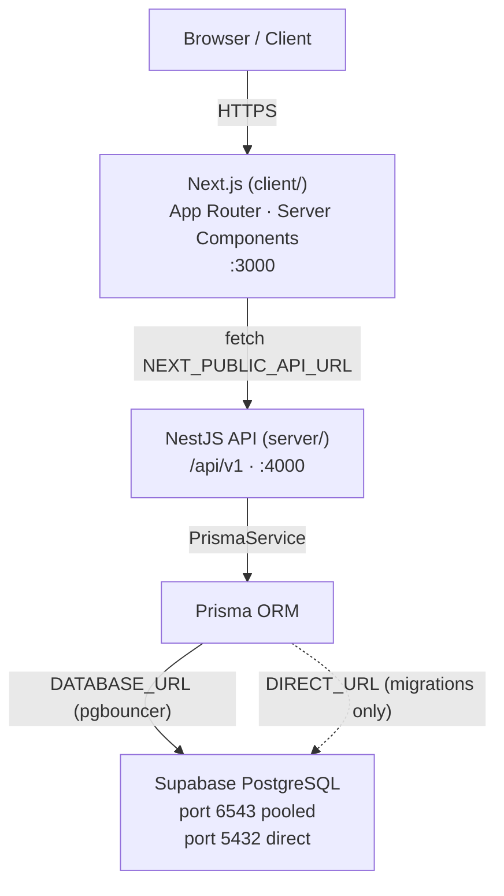

# Technical Architecture, Data Model & Admin

> **Stack decision logged 2026-09-09.** The implementation uses the concrete stack below. Sections marked _conceptual_ below have been updated to reflect the implemented choices.

## Implemented stack

| Layer           | Technology                       | Version |
| --------------- | -------------------------------- | ------- |
| Frontend        | Next.js (App Router, TypeScript) | 16.x    |
| Backend API     | NestJS (modular)                 | 12.x    |
| ORM             | Prisma                           | 6.x     |
| Database        | PostgreSQL via Supabase          | —       |
| Package manager | pnpm (workspaces)                | 12.x    |
| Monorepo layout | `client/` + `server/`            | —       |

## Architecture diagram



## Data flow

1. Browser requests a Server Component page from Next.js.
2. Server Component calls a service function in `src/services/` which uses `apiClient` to call the NestJS backend.
3. NestJS controller validates the request (`ValidationPipe`), delegates to a service, which calls `PrismaService`.
4. Prisma executes the query against Supabase PostgreSQL via the pooled connection string.
5. Response travels back: Prisma → NestJS service → NestJS controller (JSON) → Next.js Server Component → rendered HTML → Browser.

Client Components (`'use client'`) call the same NestJS API directly via `apiClient`; they never access the database directly.

## Environment strategy

| Variable                        | Used by                         | Exposed to browser               |
| ------------------------------- | ------------------------------- | -------------------------------- |
| `DATABASE_URL`                  | Prisma (server only)            | Never                            |
| `DIRECT_URL`                    | Prisma migrations (server only) | Never                            |
| `PORT`                          | NestJS bootstrap                | Never                            |
| `CORS_ORIGINS`                  | NestJS CORS                     | Never                            |
| `NEXT_PUBLIC_API_URL`           | Next.js `apiClient`             | Yes (safe — API URL only)        |
| `NEXT_PUBLIC_SITE_URL`          | Next.js metadata                | Yes (safe — site URL only)       |
| `NEXT_PUBLIC_GA_MEASUREMENT_ID` | Analytics (future)              | Yes (safe — measurement ID only) |
| `NEXT_PUBLIC_WHATSAPP_NUMBER`   | Next.js `client/src/config/whatsapp.ts` | Yes (safe — public business number) |

**Rule:** Never prefix `DATABASE_URL`, `DIRECT_URL`, or any secret with `NEXT_PUBLIC_`.

## Migration workflow

```bash
# Development: auto-migrate + regenerate client
pnpm db:migrate:dev

# Production: apply pending migrations without prompt
pnpm db:migrate:deploy

# Inspect schema changes
pnpm db:studio
```

Migrations run against `DIRECT_URL` (port 5432, bypassing pgbouncer). Runtime queries use `DATABASE_URL` (port 6543, pooled).

## NestJS module map

```
AppModule
├── ConfigModule (global)         ← env validation
├── ThrottlerModule               ← rate limiting
├── DatabaseModule (global)       ← PrismaService
├── HealthModule                  ← GET /api/v1/health
├── EnquiriesModule               ← POST /enquiries, GET /enquiries/ref/:referenceId (implemented)
│
├── [future] CustomersModule      ← internal, not public
├── [future] ServicesModule       ← GET /services
├── [future] GalleryModule        ← GET /gallery
├── [future] FaqsModule           ← GET /faqs
├── [future] ContactModule        ← POST /contact
└── [blocked] NotificationsModule ← WhatsApp / email triggers
    │   Confirmed client requirement (Sec. 06 §4). NOT built. Requires an
    │   approved WhatsApp Business Platform account (WABA ID, phone number ID,
    │   access token) and an SMTP provider with credentials. No stub, mock or
    │   success log has been added. Blocked on Sec. 11 questions 4 and 5.
    │
    └── [removed] TestimonialsModule
        No testimonials were supplied. The model remains in schema.prisma
        (Testimonial, GalleryItem, Service, FAQ, ContactRequest) but there is no
        module, no route and no seeded content. Content is static in
        client/src/content/ until a CMS exists.
```

## Next.js client structure

```
client/src/
├── app/                 ← App Router pages (Server Components by default)
│   ├── layout.tsx       ← Root layout: metadata + JSON-LD + Header/Footer
│   ├── page.tsx         ← Homepage
│   ├── about/page.tsx
│   ├── services/page.tsx
│   ├── menus/page.tsx
│   ├── gallery/page.tsx
│   ├── faq/page.tsx
│   └── contact/page.tsx
├── components/
│   ├── common/          ← SectionHeading, RevealOnScroll, WhatsAppFab, StructuredData
│   ├── hero/            ← Hero
│   ├── forms/           ← QuoteForm
│   ├── layout/          ← Header, Footer
│   └── sections/        ← homepage sections
├── config/
│   ├── routes.ts        ← Canonical route constants + primary nav
│   ├── site.ts          ← ★ Confirmed business profile — SINGLE SOURCE OF TRUTH
│   └── whatsapp.ts      ← wa.me link builder (customer-initiated)
├── content/             ← ★ Confirmed content, sourced from Sec. 16
│   ├── services.ts      ← 13 confirmed services
│   ├── cuisines.ts      ← 8 cuisines + food options + customisation policy
│   ├── facilities.ts    ← 13 confirmed facilities + support statements
│   ├── eventTypes.ts    ← form dropdown ⇄ Prisma EventType enum
│   ├── faqs.ts          ← answers traceable to client answers
│   └── gallery.ts       ← 11 confirmed photography categories
├── hooks/               ← Custom React hooks (boundary established)
├── lib/
│   └── api/
│       └── client.ts    ← Base HTTP client (wraps fetch → NestJS)
├── services/            ← Typed API call functions (one file per domain)
│   ├── health.service.ts
│   ├── enquiry.service.ts
│   └── contact.service.ts
└── types/
    └── index.ts         ← DTO types mirroring Prisma schema (enums + entities)
```

### Routes removed on 2026-09-30

| Removed              | Reason                                                                          |
| -------------------- | ------------------------------------------------------------------------------- |
| `/services/[slug]/`  | No per-service detail supplied. Thirteen generated pages would be thin content with invented copy. All services are anchored sections on `/services`. See Sec. 12. |
| `/testimonials/`     | No testimonials supplied. Removed with its nav entry and the homepage section. See Sec. 12. |

Client-side API service stubs for `services`, `gallery`, `testimonials` and
`faqs` were removed alongside: content is static and confirmed, so there is
nothing to fetch. A `Testimonial` model still exists in `schema.prisma` with no
content and no module.

## Conceptual layers

## Conceptual data entities

| Entity         | Purpose                                  | Key fields (conceptual)                                  | Notes                                                               |
| -------------- | ---------------------------------------- | -------------------------------------------------------- | ------------------------------------------------------------------- |
| Customer       | Person submitting an enquiry             | name, phone (unique), email                              | Implemented. Not a login account (out of scope)                     |
| Enquiry        | A quote request                          | eventType, eventDate, guestCount, location, status, referenceId | Implemented. `email`/`message` are nullable, accepted by the API but not collected by the form (Sec. 12) |
| EventType      | Enum: one member per confirmed service   | 13 members — see Sec. 05 for the full mapping            | Extended 2026-09-30: added ENGAGEMENT, ANNIVERSARY, OFFICE_BUSINESS, HOUSE_PARTY, INSTITUTIONAL. Additive only |
| Service        | A catering service category              | name, description                                        | Content is static in `client/src/content/services.ts` — no module, no API |
| Menu / Package | Structured offering                      | cuisine, courses, tier                                    | **Deferred.** No menu document supplied; pricing quoted per enquiry, never published (Sec. 05) |
| GalleryItem    | A published photo                        | category, alt text, caption, image asset                  | **No content.** 11 confirmed categories in `client/src/content/gallery.ts`; images not supplied |
| Testimonial    | Published review                         | name, event type, quote, moderation status                | **Model only, no content, no route.** None supplied (Sec. 12)      |
| FAQ            | Published Q&A                            | question, answer, category                                | Content is static in `client/src/content/faqs.ts` — no module, no API |
| ContactRequest | Generic contact (vs. structured enquiry) | name, phone/email, message                                | Model only. The site routes all contact through the enquiry form   |
| LeadStatus     | Enum tracking Enquiry state              | see Sec. 06 lifecycle                                     | Implemented                                                        |

### Migrations

There is deliberately **no** `server/prisma/migrations/` directory: this project
has never been connected to a database, so there is no baseline to extend and
no migration history to preserve. Create the baseline against a fresh Supabase
project with `pnpm db:migrate:dev` — the first generated migration will already
include the extended `EventType` enum, because `schema.prisma` is the source of
truth. Do not hand-write a partial migration against a database that has no
baseline.

**No database connectivity has been tested.** No Supabase credentials exist in
this environment, so persistence has not been verified against a live database.

Data store: **Supabase PostgreSQL** via Prisma. `DATABASE_URL` is the pooled
connection (port 6543, `?pgbouncer=true`); `DIRECT_URL` is the direct connection
(5432) used for migrations only. Both are server-side secrets and must never be
exposed to the browser or prefixed with `NEXT_PUBLIC_`.

## Content ownership (no CMS)

Confirmed content is **static, version-controlled code** in
`client/src/config/site.ts` and `client/src/content/*.ts`. There is no CMS, no
admin UI and no content API. Editing confirmed business facts means editing
those files and deploying.

This is a deliberate choice for a 7-route site whose content changes when the
client supplies a document, not weekly.

| Content               | Current state                                                  | Needs a CMS when                          |
| --------------------- | -------------------------------------------------------------- | ----------------------------------------- |
| Services, event types  | Static, from the client's confirmed list                       | Service-specific detail per service is supplied |
| Cuisines, food options | Static, confirmed list                                         | A menu/package document is supplied       |
| Facilities            | Static, confirmed list                                         | Rarely — unlikely to need a CMS           |
| FAQs                   | Static, from direct client answers                             | The client supplies their own FAQ list    |
| Contact info           | `client/src/config/site.ts`                                    | A second contact person is added          |
| Gallery                | Categories only; no images                                     | Images are supplied and updates become routine |
| Menus/packages         | **Deferred** — nothing to manage yet                           | A menu document is supplied               |
| Testimonials           | **None** — no content to manage                                | Permission-cleared testimonials are supplied |
| SEO metadata           | Per-route `metadata` export                                    | Non-technical staff need to edit it       |
| Offers/promotions      | Not required at V1                                              | —                                         |

Do not introduce a full admin dashboard unless justified by content-update
frequency — start with the minimum needed to keep content current without a
developer. An admin panel is **not** part of the current architecture even
though the client mentioned "Website/Admin Panel" as a notification destination
(Sec. 06 §4): no such interface exists.

## Analytics events

**Not implemented.** No analytics provider is configured, and the client has not
approved one. Instrumenting the site would collect visitor data beyond the
enquiry fields the client consented to.

The list below is **proposed**, not implemented, and requires explicit client
approval before any provider is added:

`page_view, service_view, menu_view, gallery_open, quote_cta_click, quote_form_start, quote_form_submit, whatsapp_click, phone_click, email_click`

Note `testimonial_view` is deliberately absent — there is no testimonial content
to measure.

Funnel: `Visitors → Service Views → Quote CTA Clicks → Form Starts → Form Submissions → Qualified Leads → Quotes → Confirmed Events`

## Security & privacy

HTTPS everywhere, server-side form validation, spam/rate-limit protection, secure storage of lead PII (phone numbers especially), access control on who can view lead data internally, a privacy policy, and a cookie policy if analytics/marketing cookies are used. Do not claim legal compliance (DPDP, etc.) without actual verification.

## Integrations

| Tier                    | Integration                                                       |
| ----------------------- | ----------------------------------------------------------------- |
| Core (required)         | WhatsApp, Email, Phone                                            |
| Recommended (near-term) | Google Business Profile, Analytics, Search Console                |
| Future                  | CRM, social media auto-post, email marketing, automated follow-up |
